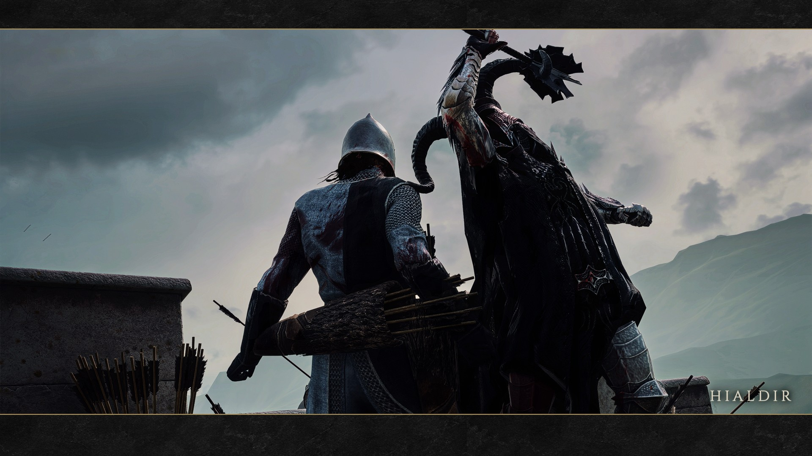
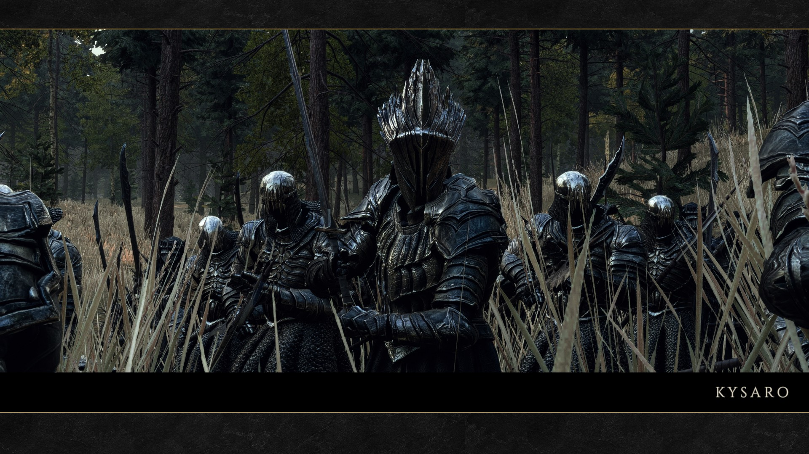
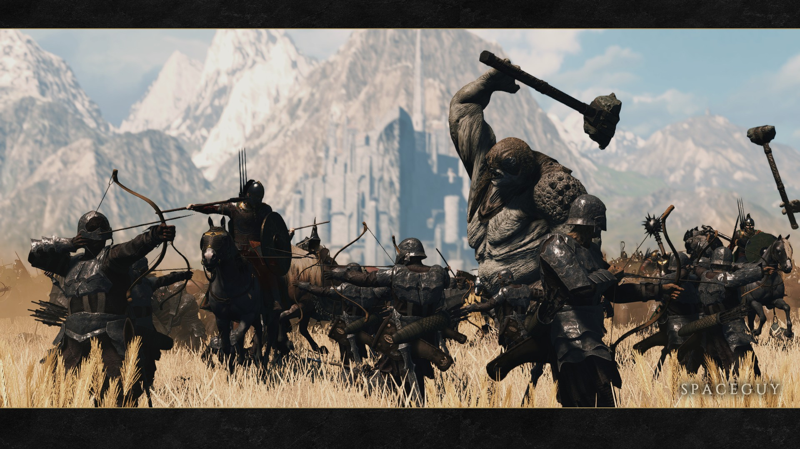
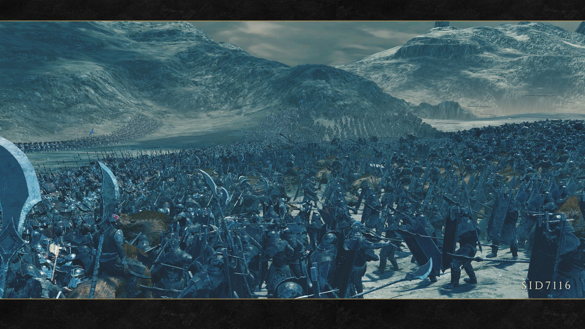
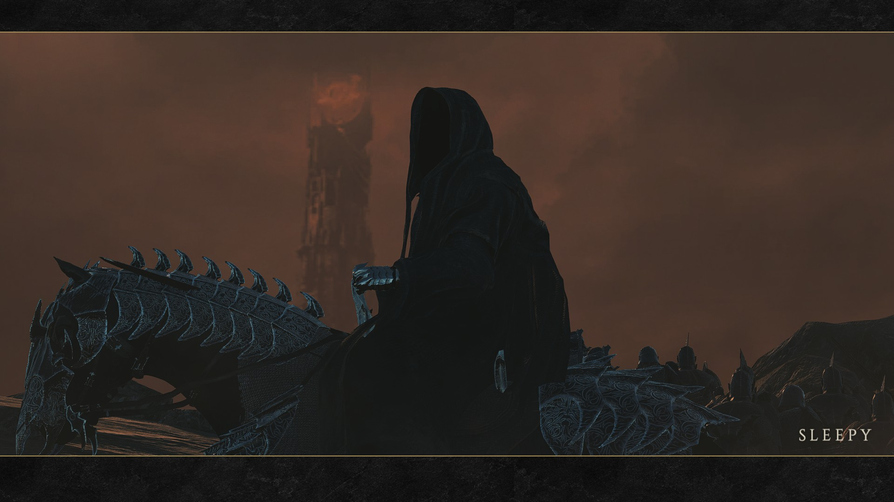

# TAOM Extra Loading Screens

> [!CAUTION]
> **Important: read this before you download.**
>
> 1. Download the mod here: **[TAOM-ExtraLoadingScreens-v1.0.0.zip](https://github.com/MinimalCash63/TAOM-Extra-Loading-Screens/releases/download/v1.0.0/TAOM-ExtraLoadingScreens-v1.0.0.zip)**. It's also under [Releases](https://github.com/MinimalCash63/TAOM-Extra-Loading-Screens/releases/latest), on the right side of this page.
> 2. Do **not** use the green **Code → Download ZIP** button. It only gives you this page's text and preview pictures, not the mod, so the launcher won't show anything.
> 3. Open the zip and drag the `TAOM-ExtraLoadingScreens` folder into your Bannerlord `Modules` folder. Done.
>
> Check: inside `Modules\TAOM-ExtraLoadingScreens` you should see `SubModule.xml` and a `bin` folder right away. If you see another folder of the same name inside instead, move that inner folder into `Modules`.

Adds extra loading screen pictures to TAOM (Tales from the Age of Men) on Mount & Blade II: Bannerlord 1.5.7. TAOM's own loading pictures stay; the new ones are shown among them, picked at random like TAOM's.

Download: see [Releases](../../releases). Current version: v1.0.0.

Picture by Hialdir. A few more of the 30, as they look in game:

| | |
|---|---|
|  Picture by Kysaro |  Picture by SpaceGuy |
|  Picture by sid7116 |  Picture by Sleepy |

## The pictures

All 30 pictures are in-game screenshots, taken from the community's screenshots in TAOM's official Discord. Each picture carries its artist's name in the bottom right corner.

## Requirements

- Mount & Blade II: Bannerlord 1.5.7
- TAOM 2.0.41, with TAOM.Dependencies

This module uses the Harmony library bundled in TAOM.Dependencies.

## Install

1. Download the zip from Releases.
2. Copy the `TAOM-ExtraLoadingScreens` folder into Bannerlord's `Modules` folder. If Windows' Extract All made an extra folder around it, copy the inner one.
3. In the launcher, tick "TAOM Extra Loading Screens". It loads after TAOM; its place below TAOM does not matter.

The pictures show only while TAOM's own setting "Themed Loading Screens" is on (Mod Options > TAOM - Tales From the Age of Men > Menus & Loading Screens; on by default). With that setting off, the game's own loading pictures show instead of TAOM's pictures and these.

To remove: untick it in the launcher, or delete the folder. Saves are not affected.

## Co-op

- Loading screens are drawn on each player's own PC. Nothing is shared or synced.
- Co-op wants every player to tick the same modules, so either every player ticks this module or nobody does.

## How it works

TAOM picks a random picture from its own folder for each loading screen. This module adds its pictures to that list while the game runs. It changes no file of TAOM or of any other mod. If a TAOM update changes how TAOM lists its pictures, this module may add nothing. Its log is `Documents\Mount and Blade II Bannerlord\Logs\taom_extra_loading_screens.log`.

## Reporting a problem

Open an issue on this repository. Say which TAOM version you use and attach the log file named above.

## Credits

- Loading screen art by: Hialdir; Linden; Caveman; инсайт (insit7151); sid7116; Khamzra Hamûlid, the Two-Crowned; SpaceGuy; Sleepy; Linus; TimeAndSpace; Elendil the Tall; Kysaro; Hircine; TukTuk; Beregond "le Fidèle". The artists posted these pictures in TAOM's official Screenshots channel on Discord. If one of them is yours and you want it changed or removed, open an issue on this repository.
- Loading window and picture loader: the TAOM team (loading window design by Kysaro). This module only adds pictures to it.
- Module: MinimalCash63.

## License

See [LICENSE](LICENSE). The pictures belong to their artists.
